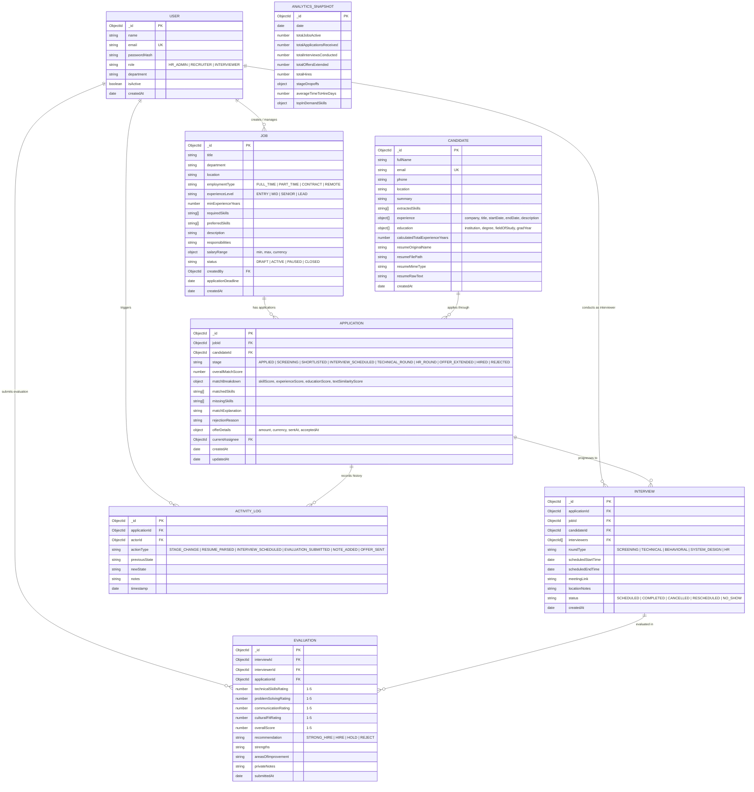
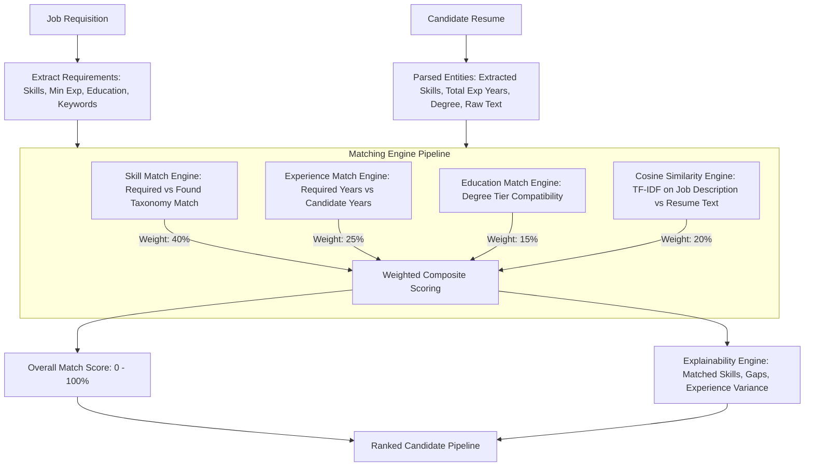

# AI-Enabled Recruitment & Candidate Tracking Platform (TalentPulse)
## System Architecture & Technical Specification Blueprint

---

### Executive Summary & Workspace Inspection
- **Workspace Status**: Inspected `c:\Users\VISHAAL MANIKANDAN\Downloads\FSD project`. The root directory is currently empty with no pre-existing files or conflicting configurations.
- **Application Goal**: Enterprise-ready, role-governed Applicant Tracking System (ATS) powered by resume parsing (PDF/DOCX), an explainable NLP matching & ranking engine (cosine similarity + weighted factor scoring), Kanban recruitment pipeline, automated interview scheduling, email alerts via cron, and recruitment analytics (CSV/PDF export).

---

## 1. Folder Structure Blueprint

A modular client-server architecture (`client/` for React + Tailwind, `server/` for Node.js + Express + Mongoose):

```
FSD project/
│
├── package.json                   # Root orchestrator scripts (concurrently dev runner)
├── .gitignore                     # Git ignore rules for node_modules, .env, uploads
├── README.md                      # Project setup & run documentation
│
├── server/                        # Backend Application (Node.js + Express)
│   ├── package.json
│   ├── .env.example
│   ├── server.js                  # App bootstrap, MongoDB connection, server listener
│   │
│   ├── src/
│   │   ├── config/                # Environment, DB, Mailer, and Multer config
│   │   │   ├── db.js              # Mongoose connection & connection pool
│   │   │   ├── mailer.js          # Nodemailer SMTP transporter & templates
│   │   │   └── multer.js          # Multer file upload storage & MIME filter
│   │   │
│   │   ├── constants/             # Enums, roles, status codes, skill taxonomies
│   │   │   ├── roles.js           # HR_ADMIN, RECRUITER, INTERVIEWER
│   │   │   ├── applicationStages.js # APPLIED, SCREENING, SHORTLISTED, INTERVIEW_SCHEDULED, TECHNICAL_ROUND, HR_ROUND, OFFER_EXTENDED, HIRED, REJECTED
│   │   │   └── skillTaxonomy.js   # Curated technical, domain & soft skills lexicon
│   │   │
│   │   ├── models/                # Mongoose Schemas & Models
│   │   │   ├── User.js            # User accounts, auth, roles
│   │   │   ├── Job.js             # Job requisitions, requirements, status
│   │   │   ├── Candidate.js       # Candidate profile, parsed resume metadata
│   │   │   ├── Application.js     # Job-Candidate association, stage, match scores
│   │   │   ├── Interview.js       # Scheduled interviews, rounds, calendar links
│   │   │   ├── Evaluation.js      # Scorecard ratings, interviewer feedback
│   │   │   ├── ActivityLog.js     # Audit trail of pipeline transitions & edits
│   │   │   └── AnalyticsSnapshot.js # Aggregated metrics cache for fast reporting
│   │   │
│   │   ├── middleware/            # Express Middleware
│   │   │   ├── auth.middleware.js # JWT verification & user attachment
│   │   │   ├── rbac.middleware.js # Role-based access control guards
│   │   │   ├── validate.middleware.js # Joi/Zod request payload validation
│   │   │   ├── upload.middleware.js   # Multer file validation (PDF/DOCX, 10MB limit)
│   │   │   └── error.middleware.js    # Global error handler & standard JSON error envelopes
│   │   │
│   │   ├── services/              # Core Business Logic & Algorithms
│   │   │   ├── parser/            # Resume Parsing Engine
│   │   │   │   ├── pdfParser.js   # pdf-parse text extraction
│   │   │   │   ├── docxParser.js  # mammoth DOCX extraction
│   │   │   │   └── entityExtractor.js # Regex & heuristic extraction for email, phone, skills, experience, education
│   │   │   │
│   │   │   ├── matching/          # AI / NLP Matching Engine
│   │   │   │   ├── tokenizer.js   # Stemming, stop-word removal, n-grams
│   │   │   │   ├── vectorizer.js  # TF-IDF calculation & term vectors
│   │   │   │   ├── similarity.js  # Cosine similarity calculation
│   │   │   │   ├── scoringEngine.js # Multi-factor weighted composite scoring
│   │   │   │   └── explainer.js   # Generates human-readable scoring rationale & gaps
│   │   │   │
│   │   │   ├── emailService.js    # Automated email dispatch (invites, rejections, offers)
│   │   │   ├── exportService.js   # CSV generation (json2csv) & PDF reporting (pdfkit)
│   │   │   └── analyticsService.js# Mongo aggregate pipelines (funnel, time-to-hire, source stats)
│   │   │
│   │   ├── jobs/                  # Automated Cron Tasks
│   │   │   ├── cronScheduler.js   # Central node-cron manager
│   │   │   ├── interviewReminders.cron.js # 24h & 1h interview email notifications
│   │   │   └── analyticsRollup.cron.js    # Daily snapshot aggregation
│   │   │
│   │   ├── controllers/           # HTTP Request Handlers
│   │   │   ├── auth.controller.js
│   │   │   ├── user.controller.js
│   │   │   ├── job.controller.js
│   │   │   ├── candidate.controller.js
│   │   │   ├── application.controller.js
│   │   │   ├── interview.controller.js
│   │   │   ├── evaluation.controller.js
│   │   │   └── analytics.controller.js
│   │   │
│   │   ├── routes/                # Express Route Declarations
│   │   │   ├── auth.routes.js
│   │   │   ├── user.routes.js
│   │   │   ├── job.routes.js
│   │   │   ├── candidate.routes.js
│   │   │   ├── application.routes.js
│   │   │   ├── interview.routes.js
│   │   │   ├── evaluation.routes.js
│   │   │   ├── analytics.routes.js
│   │   │   └── index.js           # Master router aggregator (/api/v1)
│   │   │
│   │   └── utils/                 # Helpers
│   │       ├── apiResponse.js     # Standard response envelope: { success, data, message, meta }
│   │       ├── apiError.js        # Custom ApiError class extending Error
│   │       └── logger.js          # Structured console logger
│   │
│   └── uploads/                   # Stored resume documents (.pdf, .docx)
│       └── resumes/
│
└── client/                        # Frontend Application (React + Vite + Tailwind CSS)
    ├── package.json
    ├── vite.config.js
    ├── tailwind.config.js
    ├── postcss.config.js
    ├── index.html
    │
    └── src/
        ├── main.jsx               # React DOM root
        ├── App.jsx                # Router provider & global context wraps
        ├── index.css              # Tailwind imports, custom CSS variables & scrollbars
        │
        ├── assets/                # Logos, icons, empty-state illustrations
        │
        ├── api/                   # Axios HTTP Client & API abstraction
        │   ├── axiosClient.js     # Axios instance with JWT interceptor & auto-refresh
        │   ├── authApi.js
        │   ├── jobApi.js
        │   ├── candidateApi.js
        │   ├── applicationApi.js
        │   ├── interviewApi.js
        │   ├── evaluationApi.js
        │   └── analyticsApi.js
        │
        ├── context/               # Global State (Context API)
        │   ├── AuthContext.jsx    # User session, JWT tokens, RBAC permissions
        │   ├── NotificationContext.jsx # Toast notifications & live banners
        │   └── PipelineContext.jsx # Shared Kanban pipeline state & optimistic updates
        │
        ├── routes/                # Routing setup & Guards
        │   ├── AppRoutes.jsx      # Route map
        │   ├── ProtectedRoute.jsx # Auth validation
        │   └── RoleGuard.jsx      # RBAC permission check
        │
        ├── layouts/               # Page Shells
        │   ├── DashboardLayout.jsx# Sidebar, Topbar, Breadcrumbs, Notifications
        │   └── AuthLayout.jsx     # Centered card layout for Login / Register
        │
        ├── components/            # Reusable UI Components
        │   ├── common/            # Button, Input, Modal, Dropdown, Badge, Table, Spinner, Toast
        │   ├── kanban/            # KanbanBoard, KanbanColumn, CandidateCard, DragDropWrapper
        │   ├── charts/            # FunnelChart, TimeToHireChart, SkillRadarChart, SourceDonut
        │   ├── matching/          # MatchScoreGauge, SkillBreakdownBadge, MatchExplanationModal
        │   └── interview/         # CalendarView, ScheduleModal, FeedbackFormModal
        │
        ├── pages/                 # Route Views
        │   ├── auth/              # Login, Register, ForgotPassword
        │   ├── dashboard/         # Role-specific executive home view
        │   ├── jobs/              # JobList, JobDetails, JobCreateModal, JobEdit
        │   ├── pipeline/          # Interactive Kanban board for candidates per job
        │   ├── candidates/        # CandidateDirectory, CandidateProfile, ResumeViewerModal
        │   ├── interviews/        # InterviewScheduleCalendar, InterviewList, EvaluationView
        │   ├── analytics/         # Deep-dive analytics, KPI cards, CSV/PDF export controls
        │   └── settings/          # User management (HR Admin only), system configurations
        │
        ├── hooks/                 # Custom React Hooks
        │   ├── useAuth.js
        │   ├── useDebounce.js
        │   └── useFetch.js
        │
        └── utils/                 # Client helpers
            ├── formatters.js      # Date, currency, percentage, score formatting
            └── colorMaps.js       # Match score colors (e.g., >80% Green, 60-79% Amber, <60% Slate)
```

---

## 2. Database Entity Relationship (ER) & Schema Design



### Essential Indexes
- `User`: `{ email: 1 }` (unique)
- `Job`: `{ status: 1, department: 1, createdAt: -1 }`
- `Candidate`: `{ email: 1 }` (unique), `{ extractedSkills: 1 }`
- `Application`: `{ jobId: 1, candidateId: 1 }` (unique compound index), `{ jobId: 1, stage: 1 }`, `{ overallMatchScore: -1 }`
- `Interview`: `{ applicationId: 1 }`, `{ scheduledStartTime: 1, status: 1 }`
- `Evaluation`: `{ interviewId: 1, interviewerId: 1 }` (unique compound index)
- `ActivityLog`: `{ applicationId: 1, timestamp: -1 }`

---

## 3. API Architecture

- **Pattern**: RESTful architecture over JSON envelopes.
- **Base URI**: `/api/v1`
- **Standardized Response Envelope**:
  ```json
  {
    "success": true,
    "statusCode": 200,
    "message": "Operation completed successfully",
    "data": { },
    "meta": {
      "page": 1,
      "limit": 20,
      "totalRecords": 85,
      "totalPages": 5
    }
  }
  ```
- **Standardized Error Envelope**:
  ```json
  {
    "success": false,
    "statusCode": 400,
    "message": "Validation Error",
    "errors": [
      { "field": "email", "message": "Valid email address is required" }
    ],
    "timestamp": "2026-09-30T18:30:00.000Z"
  }
  ```

---

## 4. Authentication & Authorization Architecture

### 1. Token Mechanism
- **Access Token**: Short-lived JSON Web Token (15-60 min validity) containing `{ userId, email, role, department }` signed via HMAC SHA-256 (`process.env.JWT_SECRET`). Sent in HTTP Header: `Authorization: Bearer <token>`.
- **Refresh Token**: Long-lived token (7 days) stored as an `httpOnly, secure, SameSite=Strict` cookie or database document for seamless re-authentication without session disruption.
- **Password Security**: Bcrypt with minimum 12 salt rounds on creation and password updates.

### 2. Role-Based Access Control (RBAC) Matrix
| Module / Capability | HR Administrator | Recruiter | Technical Interviewer |
| :--- | :---: | :---: | :---: |
| User Management & Role Assignment | Full CRUD | No Access | No Access |
| Create / Edit / Close Jobs | Full CRUD | Full CRUD | Read-Only |
| Upload & Parse Resumes | Full Access | Full Access | No Access |
| View Candidates & AI Match Scores | Full Access | Full Access | Assigned Candidates Only |
| Move Stages on Kanban Pipeline | Full Access | Full Access | Read-Only / Stage Transition Restricted |
| Schedule Interviews & Assign Rounds| Full Access | Full Access | Read Calendar / Accept |
| Submit Interview Evaluations & Ratings| Full Access | Read evaluations | Create & Edit Own Evaluations |
| Extend Job Offers & Final Status | Full Access | Full Access | No Access |
| Export CSV/PDF Reports & Metrics | Full Access | Full Access | Restricted / Own Metrics |

---

## 5. Frontend Route Structure

| Route | Component View | Permitted Roles | Functionality |
| :--- | :--- | :--- | :--- |
| `/login` | `LoginPage` | Public | Email/Password login, token persistence |
| `/register` | `RegisterPage` | Public (or Admin Invite) | Initial onboarding |
| `/dashboard` | `DashboardHome` | All authenticated | Role-tailored metrics, task queue, interview timeline |
| `/jobs` | `JobListPage` | All authenticated | Searchable job requisition catalog with status badges |
| `/jobs/new` | `JobCreatePage` | HR_ADMIN, RECRUITER | Form wizard for requirements, skills, salary, weights |
| `/jobs/:id` | `JobDetailsPage` | All authenticated | Job overview, requirements, applicant statistics |
| `/jobs/:id/pipeline` | `KanbanPipelinePage` | All authenticated | Drag-and-drop candidate stage progression, quick match scores |
| `/candidates` | `CandidateDirectory` | All authenticated | Global candidate database, skill search, batch resume upload |
| `/candidates/:id` | `CandidateProfilePage` | All authenticated | Full profile, parsed resume text, experience timeline, match histories |
| `/applications/:id` | `ApplicationDetailsPage` | All authenticated | AI Match scorecard, explainability modal, stage history, evaluation feed |
| `/interviews` | `InterviewCalendarPage` | All authenticated | Interactive calendar & list view of scheduled technical/HR rounds |
| `/interviews/:id/evaluate` | `SubmitEvaluationModal` | HR_ADMIN, RECRUITER, INTERVIEWER | Rating metrics (1-5), notes, Hire/Reject recommendation |
| `/analytics` | `AnalyticsDashboard` | HR_ADMIN, RECRUITER | Charts (funnel, time-to-hire, skill trends), CSV export, PDF report export |
| `/settings/users` | `UserManagementPage` | HR_ADMIN | Invite users, modify roles, deactivate accounts |

---

## 6. Backend Route Structure

### `/api/v1/auth`
- `POST /register`: Register user (Protected or Initial Seed)
- `POST /login`: Authenticate credentials, return access token + user payload
- `POST /refresh-token`: Refresh expired access token
- `POST /logout`: Invalidate refresh token session
- `GET  /me`: Return current logged-in user profile

### `/api/v1/jobs`
- `GET    /`: List jobs with pagination, department/status filters
- `POST   /`: Create job requisition (HR_ADMIN, RECRUITER)
- `GET    /:id`: Retrieve job details + summary applicant count
- `PUT    /:id`: Update job requirements / details
- `PATCH  /:id/status`: Toggle job status (DRAFT, ACTIVE, PAUSED, CLOSED)
- `DELETE /:id`: Archive or delete job requisition

### `/api/v1/candidates`
- `GET    /`: Search and list candidates with skill and experience filtering
- `POST   /upload-resume`: Upload single/batch resumes (Multer), parse text, extract entities, create candidate records
- `GET    /:id`: Retrieve candidate profile with complete parsed history
- `PUT    /:id`: Manually update candidate attributes or verified skills
- `GET    /:id/resume`: Download or stream original resume file

### `/api/v1/applications`
- `GET    /job/:jobId`: Get all applications for a job (powers the Kanban board)
- `POST   /`: Associate candidate to job (triggers immediate AI Match calculation)
- `GET    /:id`: Detailed application view with match score and explainability
- `PATCH  /:id/stage`: Move candidate to new stage (Kanban drag-and-drop trigger, creates ActivityLog, triggers email notification if applicable)
- `POST   /:id/re-rank`: Force re-evaluation of candidate matching score against updated job description

### `/api/v1/interviews`
- `GET    /`: List interviews filtered by date, job, or interviewerId
- `POST   /`: Schedule an interview round with notifications to candidate & panel
- `GET    /:id`: Get interview details, links, and evaluations
- `PUT    /:id`: Reschedule interview
- `PATCH  /:id/status`: Update status (COMPLETED, CANCELLED, NO_SHOW)

### `/api/v1/evaluations`
- `POST   /`: Submit interviewer scorecard rating (1-5) and feedback
- `GET    /application/:applicationId`: Retrieve all scorecard evaluations for candidate
- `PUT    /:id`: Edit evaluation before final lock

### `/api/v1/analytics`
- `GET    /overview`: Top-level KPIs (Total jobs, active candidates, time-to-hire, offer accept rate)
- `GET    /funnel`: Stage-by-stage conversion drop-off rates
- `GET    /skills-demand`: In-demand vs. applicant-supplied skill distributions
- `GET    /export/csv`: Stream CSV file of application data
- `GET    /export/pdf`: Generate printable PDF summary report

---

## 7. Matching Algorithm Architecture

The matching engine provides **deterministic, transparent, and explainable AI scores** to avoid black-box bias.



### Mathematical Formulation
$$\text{Overall Score} = (S_{\text{skills}} \times 0.40) + (S_{\text{exp}} \times 0.25) + (S_{\text{edu}} \times 0.15) + (S_{\text{cosine}} \times 0.20)$$

1. **Skill Matching Score ($S_{\text{skills}}$)**:
   - Direct match against `requiredSkills` (weighted 75%) and `preferredSkills` (weighted 25%).
   - Normalization using token stemming and alias mapping (e.g., `NodeJS` = `Node.js` = `Express`).
2. **Experience Score ($S_{\text{exp}}$)**:
   - If $\text{CandidateExp} \ge \text{JobRequiredExp}$: $100\%$.
   - If $\text{CandidateExp} < \text{JobRequiredExp}$: $\max(0, (\text{CandidateExp} / \text{JobRequiredExp}) \times 100)\%$.
3. **Education Score ($S_{\text{edu}}$)**:
   - Tiered ordinal mapping: Ph.D. (100) > Master's (90) > Bachelor's (80) > Associate/Diploma (65) > High School (50).
4. **Cosine Text Similarity ($S_{\text{cosine}}$)**:
   - TF-IDF Vectorizer computes cosine similarity between cleaned, lemmatized Job Description and Resume Raw Text:
     $$\text{Cosine Similarity} = \frac{\mathbf{A} \cdot \mathbf{B}}{\|\mathbf{A}\| \|\mathbf{B}\|}$$
5. **Explainability Output Structure**:
   ```json
   {
     "overallScore": 88,
     "breakdown": {
       "skillsScore": 92,
       "experienceScore": 100,
       "educationScore": 85,
       "textSimilarityScore": 72
     },
     "matchedSkills": ["React", "Node.js", "MongoDB", "Tailwind CSS", "REST API"],
     "missingSkills": ["Docker", "AWS"],
     "experienceYears": { "required": 3, "candidate": 4.5 },
     "summaryReason": "Candidate exceeds the minimum experience requirement by 1.5 years and matches 5 of 7 required skills, demonstrating strong full-stack capability."
   }
   ```

---

## 8. File Upload & Resume Parsing Architecture

1. **Upload Interception (`Multer`)**:
   - Accepts `.pdf`, `.docx`, `.doc`.
   - File size ceiling: 10MB.
   - Saves to disk with cryptographically secure UUID prefix: `uploads/resumes/<uuid>-<sanitized-filename>`.
2. **Text Extraction Subsystem**:
   - **PDF**: Processed via `pdf-parse` (streaming buffer into string representation).
   - **DOCX**: Processed via `mammoth.extractRawText` preserving semantic layout.
3. **Entity Extraction Pipeline (`entityExtractor.js`)**:
   - **Contact Information**:
     - Email: RFC-5322 compliant regex.
     - Phone: International and domestic E.164 pattern matches.
     - Candidate Name: Evaluates upper header section, stripping common stopwords.
   - **Skills Extraction**:
     - Tokenizes text, matches against a multi-domain skill dictionary (500+ curated tech, data, and business skills).
     - Handles synonyms and variations (`React.js`, `ReactJS`, `react`).
   - **Experience & Chronology**:
     - Identifies date spans (e.g., `Jan 2021 - Present`, `2018 - 2022`).
     - Aggregates duration to calculate `calculatedTotalExperienceYears`.
   - **Education**:
     - Pattern matches for degree credentials (`B.Tech`, `B.S.`, `M.S.`, `MBA`, `Ph.D.`, `Bachelor`, `Master`).

---

## 9. Scheduling & Automation Architecture

1. **Automated Cron Jobs (`node-cron`)**:
   - **Interview Reminder Cron** (Every 30 minutes):
     - Queries `Interview` collection for events starting in $t \in [23.5\text{h}, 24.5\text{h}]$ or $[0.5\text{h}, 1.5\text{h}]$.
     - Dispatches personalized calendar notification emails to both candidate and interviewers with meeting links.
   - **Stale Candidate Alert Cron** (Daily at 08:00 AM):
     - Detects applications remaining in `APPLIED` or `SCREENING` for $> 7$ days.
     - Dispatches digest alert to assigned Recruiters.
   - **Analytics Rollup Cron** (Daily at Midnight):
     - Aggregates daily stage transitions and saves cached `AnalyticsSnapshot`.
2. **Email Notification Engine (`Nodemailer`)**:
   - Configurable SMTP (Gmail, SendGrid, or local MailHog/Ethereal for dev).
   - Pre-formatted responsive HTML email templates:
     - Application Received confirmation.
     - Interview Invitation with Calendar ICS attachment.
     - Offer Letter announcement.
     - Polite status update / rejection notice.

---

## 10. Analytics & Reporting Architecture

### Aggregation Metrics
1. **Recruitment Funnel**:
   - Counts candidates across: `APPLIED` $\rightarrow$ `SCREENING` $\rightarrow$ `SHORTLISTED` $\rightarrow$ `INTERVIEW_SCHEDULED` $\rightarrow$ `TECHNICAL_ROUND` $\rightarrow$ `HR_ROUND` $\rightarrow$ `OFFER_EXTENDED` $\rightarrow$ `HIRED`.
   - Calculates drop-off percentage at each milestone.
2. **Time-to-Hire Velocity**:
   - Average duration in days from `Application.createdAt` to `Application.stage == 'HIRED'`.
3. **Interviewer Score Distribution**:
   - Normalized variance across technical vs. cultural fit ratings to identify harsh or lenient interview panels.
4. **Export Engines**:
   - **CSV Export (`json2csv`)**: High-performance streaming export of candidate applications, scores, and status history.
   - **PDF Report (`pdfkit`)**: Generates formatted executive summary sheets with job status, applicant volume, and pipeline health charts.

---

## Verification & Implementation Phasing Plan

- **Phase 1**: Environment setup, Express backend foundation, Mongoose schemas, and JWT/RBAC auth middleware.
- **Phase 2**: File upload pipeline (Multer) & Resume parsing engine (`pdf-parse`, `mammoth`, entity regex extraction).
- **Phase 3**: NLP tokenization, TF-IDF vectorization, Cosine Similarity, and weighted matching/ranking engine.
- **Phase 4**: Job requisition management, candidate application lifecycle, and interactive Kanban stage management API.
- **Phase 5**: Interview scheduling system, scorecard evaluation modules, and `node-cron` background notifications.
- **Phase 6**: Frontend UI implementation with React + Vite + Tailwind CSS (Responsive Dashboard, Kanban Pipeline, Resume Viewer, Analytics Visualizations).
- **Phase 7**: End-to-end integration, CSV/PDF export, seed demonstration data, and verification.
